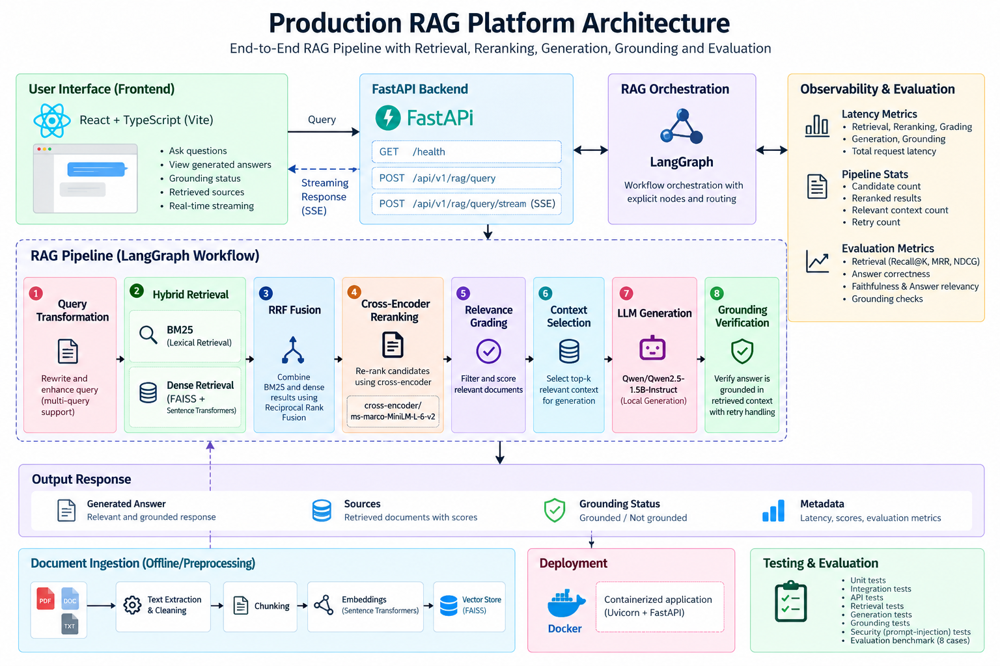

# Production RAG Platform

A production-oriented Retrieval-Augmented Generation (RAG) platform focused on reliable retrieval, reranking, grounding, evaluation, security, observability, and deployment of LLM-powered applications.

The system combines hybrid BM25 + dense retrieval, cross-encoder reranking, relevance grading, local LLM generation, grounding verification, LangGraph orchestration, FastAPI APIs, SSE streaming, a React frontend, Docker deployment, and automated evaluation.

---

## Overview

This project implements an end-to-end RAG pipeline designed around measurable retrieval and generation quality rather than relying solely on LLM output.

The implemented pipeline consists of:

1. Query transformation
2. Hybrid retrieval
   - BM25 lexical retrieval
   - Dense vector retrieval
3. Reciprocal Rank Fusion (RRF)
4. Cross-encoder reranking
5. Relevance grading
6. Context selection
7. Local LLM generation
8. Grounding verification
9. Retry handling
10. Evaluation and observability

The application is exposed through a FastAPI backend and a React + TypeScript frontend.

---

## Quick start

```bash
docker compose up --build
```

- API: http://localhost:8000 (docs at `/docs`)
- UI: http://localhost:5173

The first start downloads the models (a few GB) into the `rag-hf-cache` volume, so later starts are fast. `GET /ready` returns 503 until all models are loaded, usually 1 to 3 minutes. The image runs on CPU only (about 2.2 GB).

Configuration:

| Variable | Where | Default | Purpose |
| --- | --- | --- | --- |
| `CORS_ORIGINS` | API container | `http://localhost:5173` | Comma-separated allowed browser origins |
| `VITE_API_URL` | frontend build arg | `http://localhost:8000` | API base URL baked into the UI |

Local development without Docker:

```bash
pip install -e ".[dev]"
uvicorn rag.main:app --reload

cd frontend
npm ci
npm run dev
```

---

## API

| Endpoint | Purpose |
| --- | --- |
| `GET /health` | Process is alive |
| `GET /startup`, `GET /ready` | Model loading state (`/ready` is 503 until ready) |
| `POST /api/v1/rag/query` | Full JSON response with answer, grounding flag, sources and per-stage diagnostics |
| `POST /api/v1/rag/query/stream` | Server-Sent Events stream |

The stream emits `status`, `token` (generated text as it is produced), `answer` (the final answer, which replaces the streamed text, for example with the fallback when grounding fails), `grounding`, `sources` (only chunks accepted by the relevance grader), `complete`, and `error`.

---

## Testing

```bash
python -m pytest -q          # unit and API tests, no model downloads
python -m pytest -m model    # real-model prompt-injection tests, needs about 6 GB free RAM
```

CI runs the default suite plus the frontend lint and build on every push (`.github/workflows/ci.yml`).

---

## Performance

Measured on CPU only (8 cores, no GPU) with Qwen2.5-1.5B-Instruct, 16 sequential requests over 8 queries:

| Metric | Value |
| --- | --- |
| Mean end-to-end latency | 15.6 s |
| Median / p95 | 14.9 s / 24.9 s |
| Time to first token | about 4.4 to 4.8 s |
| Grounded responses | 16 / 16 |

Generation takes about 79% of the time and the grounding check about 19%. Retrieval plus reranking takes under 100 ms. Reproduce with `python benchmarks/benchmark_api.py` against a running API.

---

## Architecture

```text
User Query
    |
    v
Query Transformation
    |
    v
Hybrid Retrieval
(BM25 + Dense)
    |
    v
RRF Fusion
    |
    v
Cross-Encoder Reranking
    |
    v
Relevance Grading
    |
    v
Context Selection
    |
    v
Qwen LLM Generation
    |
    v
Grounding Check
    |
    v
Final Answer

### Architecture diagram



